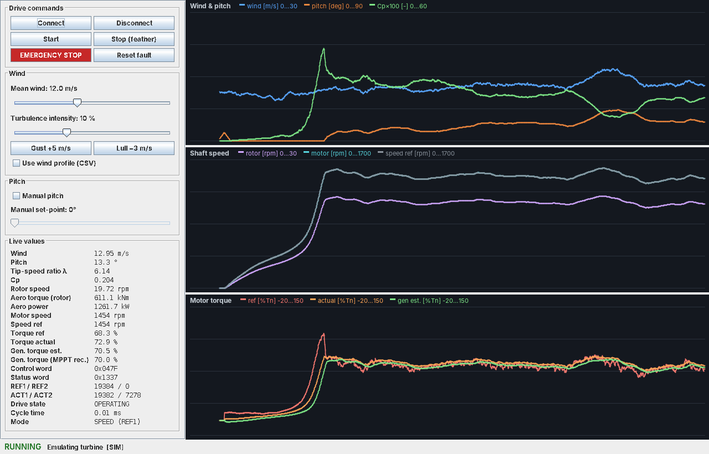

# Wind Turbine Emulator – ABB ACS800 (DTC) via RETA-01 Modbus/TCP

A Java application (JDK 17+, **no external libraries**) that turns an ACS800-driven induction motor into a
wind turbine emulator. It computes the aerodynamic behaviour of a real turbine in real time and commands the
drive through the RETA-01 Ethernet adapter over Modbus/TCP. The motor then drives a generator test bench
just as a turbine rotor would.



```
 ┌──────────────── PC (this program, 20 ms cycle) ────────────────┐          ┌─────────── test bench ───────────┐
 │ Wind model ─► Cp(λ,β) aerodynamics ─► scaling ─► REF1 / REF2   │ Modbus   │ RETA-01 ─► ACS800 (DTC) ─► Motor │
 │  mean+turb.     pitch controller       G, k_p    Control Word  │ ───TCP──►│                              │   │
 │  gusts, CSV     virtual rotor inertia            ◄─ Status Word │ ◄────────│ Status/ACT1 speed/ACT2 torque│   │
 │                 safety & state machine           ◄─ ACT1, ACT2 │          │        Generator ◄───────────┘   │
 └────────────────────────────────────────────────────────────────┘          │        + its own load drive/grid │
                                                                              └──────────────────────────────────┘
```

## Quick start

```bash
./build.sh                      # or build.bat on Windows, or: mvn package
java -jar wind-emulator.jar emulator.properties --sim          # offline, built-in drive simulator
java -jar wind-emulator.jar emulator.properties --real --host 192.168.0.16
java -jar wind-emulator.jar emulator.properties --sim --headless 120   # no GUI, prints a table
```

In the GUI: **Connect → Start**. Use the sliders for wind speed and turbulence and the gust buttons to disturb
it, or load a CSV wind profile (`wind_profile_example.csv`). **Stop** feathers the blades, waits for the rotor
to slow down, then issues OFF1. **EMERGENCY STOP** issues OFF3. Every running cycle is logged to
`emulator_log.csv`.

## What is modelled

| Block | Model |
|---|---|
| Wind | Mean value (slider or CSV, looped) + Gauss-Markov turbulence (σ = I·v, τ = L/v) + IEC-style 1-cos gusts |
| Aerodynamics | Heier/Slootweg Cp(λ,β): Cp,max = 0.48 at λ = 8.1; T = ½ρπR³v²·Cp/λ; finite start-up torque; 3P tower-shadow dip |
| Pitch | PI speed limiter above rated rotor speed, 8°/s rate limit, feathers above cut-out and on stop; manual mode |
| Rotor inertia | Full turbine inertia reflected to the motor shaft (see modes below) |
| Scaling | ω_motor = G·ω_rotor, P_motor = k_p·P_turbine, T_motor = T_rotor·k_p/G, J_motor = J_rotor·k_p/G² |
| Drive | ABB Drives profile state machine (0x0476 → 0x047F), fault reset (bit 7 edge), OFF1/OFF3 |
| Safety | Software overspeed → OFF3, torque limit and ramp, comms-loss supervision, start timeout, REMOTE check |

The default turbine is a 1.5 MW, 77 m rotor at 20 rpm, mapped onto a 15 kW / 1475 rpm motor. With these
values the program prints: G = 73.75, k_p = 0.008, rated rotor torque 716 kNm → 77.7 Nm at the motor
(80 % of T_nom), and a turbine inertia of 4·10⁶ kgm² → 5.9 kgm² at the motor shaft.

## Emulation modes (`emulator.controlMode`)

**SPEED (default, recommended).** The ACS800 runs in speed control (EXT1, REF1). The PC integrates the
virtual rotor, J_rotor·dω/dt = T_aero − T_gen. It estimates the generator torque from the drive's measured
torque (ACT2): T_gen = T_motor − J_rig·α − B·ω. This works for any inertia ratio, which matters here because a
MW turbine reflected to a small bench is many times heavier than the bench itself. Set the drive's speed
ramps (22.02 / 22.03) short, e.g. 0.5 s, and tune the speed controller stiff (autotune), so the drive
follows the virtual rotor.

**TORQUE.** The ACS800 runs in torque control (EXT2, REF2, control word bit 11 = 1). The PC sends
T_ref = T_gen,est + B·ω + r·(T_aero − T_gen,est) with r = J_rig/J_emulated. This observer-based law makes the
bench accelerate as if it had the turbine's inertia, and it stays stable at large inertia ratios. Plain
acceleration feedback, T_aero − (J_emu−J_rig)·α, limit-cycles there. Both modes were tested against the
built-in simulator at 9 and 13 m/s: they reach rated speed, pitch limits power, and there is no oscillation.

## ACS800 / RETA-01 parameter setup

> These parameter names are from the ACS800 *standard* control program. Check them against the firmware
> manual for your version. The RETA-01 values come from its user's manual.

**Fieldbus link (RETA-01)**

| Par. | Setting |
|---|---|
| 98.02 COMM. MODULE LINK | FIELDBUS |
| 98.07 COMM PROFILE | ABB DRIVES (the only profile on Modbus/TCP) |
| 51.01 MODULE TYPE | ETHERNET (read-only) |
| 51.02 COMM RATE | 0 = auto-negotiate |
| 51.03 DHCP | 0 = off (fixed IP recommended) |
| 51.04…51.07 | IP address, e.g. 192.168.0.16 (= `drive.host`) |
| 51.08…51.11 / 51.12…51.15 | Subnet mask / gateway |
| 51.16 PROTOCOL | 0 = Modbus/TCP |
| 51.17 MODBUS TIMEOUT | e.g. 10 (= 1.0 s, unit 100 ms; 0 disables it, so don't use 0) |
| 51.27 FBA PAR REFRESH | REFRESH, to apply the changes |

**Control from fieldbus**

| Par. | Setting |
|---|---|
| 99.04 MOTOR CTRL MODE | DTC |
| 99.02 APPLICATION MACRO | FACTORY (SPEED mode) or T CTRL (TORQUE mode) |
| 10.01 EXT1 STRT/STP/DIR | COMM.CW |
| 10.02 EXT2 STRT/STP/DIR | COMM.CW |
| 10.03 REF DIRECTION | FORWARD |
| 11.02 EXT1/EXT2 SELECT | COMM.CW (bit 11 selects EXT2 = torque) |
| 11.03 EXT REF1 SELECT | COMM.REF → 11.05 EXT REF1 MAXIMUM = 1500 rpm (= `drive.ref1FullScaleRpm`) |
| 11.06 EXT REF2 SELECT | COMM.REF → 11.08 EXT REF2 MAXIMUM = 100 % (= `drive.ref2FullScalePct`) |
| 16.01 RUN ENABLE | YES (or wire your hardware safety chain here) |
| 16.04 FAULT RESET SEL | COMM.CW |
| 30.18 COMM FLT FUNC | FAULT, so the drive stops itself if the PC goes silent |
| 30.19 MAIN REF DS T-OUT | 1.0 s |
| 20.01 / 20.02 | Speed limits, at or below `safety.maxMotorRpm` |
| 20.04 MAXIMUM TORQUE | Your bench's limit |

**Modbus register map used** (RETA-01: data sets in 40001…40096, parameters at 4GGII)

| Register | Content | Direction |
|---|---|---|
| 40001 | DS1.1 Control Word | PC → drive |
| 40002 | DS1.2 REF1 (speed, 20000 = 11.05) | PC → drive |
| 40003 | DS1.3 REF2 (torque, 10000 = 11.08) | PC → drive |
| 40004 | DS2.1 Status Word | drive → PC |
| 40005 | DS2.2 ACT1 (speed, 20000 = `drive.act1FullScaleRpm`) | drive → PC |
| 40006 | DS2.3 ACT2 (torque, 10000 = 100 %) | drive → PC |

Function codes: FC16 + FC03 per cycle by default, or FC23 in a single telegram (`drive.useFc23=true`).
Some masters number registers from 1 instead of 0. If the status word reads back as your reference, set
`drive.registerBase=1`. `DriveLink.readParameter(group, index)` reads any parameter (e.g. 1, 2 → 40102 =
01.02 SPEED).

## The generator side

The emulator replaces only the **turbine**. The generator coupled to the motor needs its own load: a second
drive, a grid-connected converter, or a resistor bank. Its torque control is the system under test (MPPT,
grid code, etc.). As a reference, the GUI shows "Gen. torque (MPPT rec.)", the optimal T = k_opt·ω² law
scaled to the motor shaft. The offline simulator uses that law as the load.

## Commissioning checklist

1. Run with `--sim` first and get to know the GUI, the stop behaviour and the log.
2. Real drive, motor **uncoupled**: Connect only. The status word should show REMOTE, and the state should go
   from SWITCH-ON INHIBITED to READY TO SWITCH ON. If it says "not REMOTE", check 98.02 and the
   local/remote key on the panel.
3. Lower `safety.maxMotorRpm`, `safety.maxTorquePct` and the drive limits, then Start at low wind.
4. Check signs and scaling: compare the GUI's motor speed and torque with the drive panel (01.02, 01.05).
5. Couple the generator, enable its load, then raise the wind step by step.
6. Test EMERGENCY STOP, pulling the Ethernet cable (the drive must trip on 30.18), and the hardware E-stop.

> **Safety:** this software is not a safety function. The bench must have a hardware emergency stop
> (Safe Torque Off / main contactor), guarding of the rotating parts, and drive-internal speed and torque
> limits that hold even if the PC misbehaves.

## Project layout

```
src/main/java/windemu/
  Main.java                    CLI / GUI launcher
  config/EmulatorConfig.java   all settings (emulator.properties)
  modbus/ModbusTcpClient.java  Modbus/TCP master (FC03, 06, 16, 23)
  drive/AbbDrivesProfile.java  control/status word bits, state names
  drive/RetaDriveLink.java     RETA-01 data-set & parameter access
  drive/SimulatedDriveLink.java  offline ACS800 + bench model
  turbine/WindModel.java       wind: mean, turbulence, gusts, CSV profile
  turbine/CpModel.java         Cp(λ,β)
  turbine/PitchController.java pitch PI + feather
  turbine/WindTurbineModel.java aerodynamics + scaling
  control/EmulatorController.java real-time loop, state machine, safety, logging
  ui/EmulatorGui.java, StripChart.java  Swing operator panel
```
